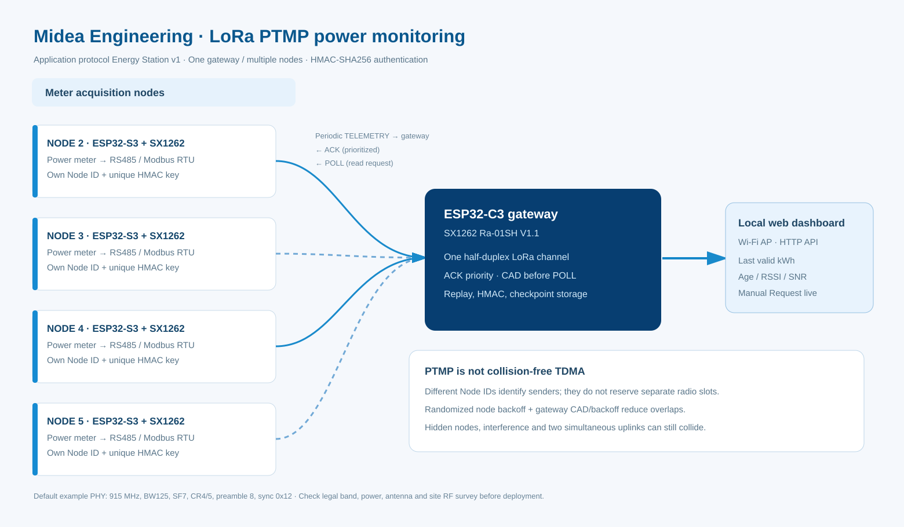
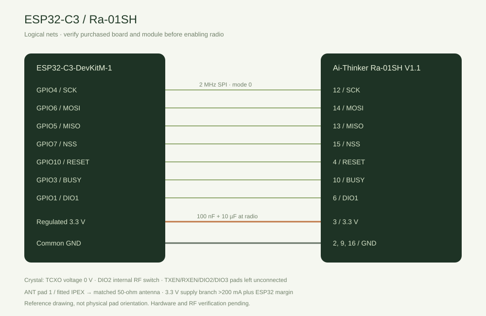
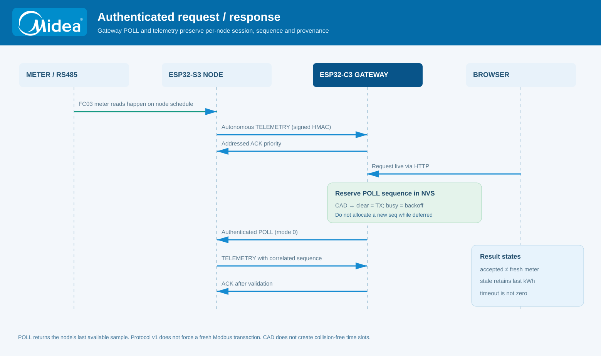
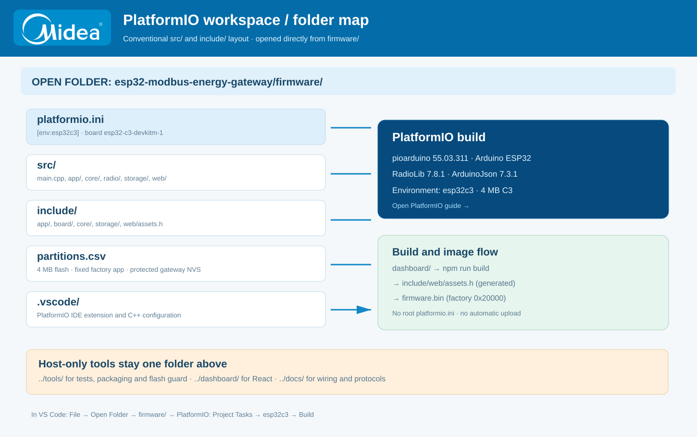
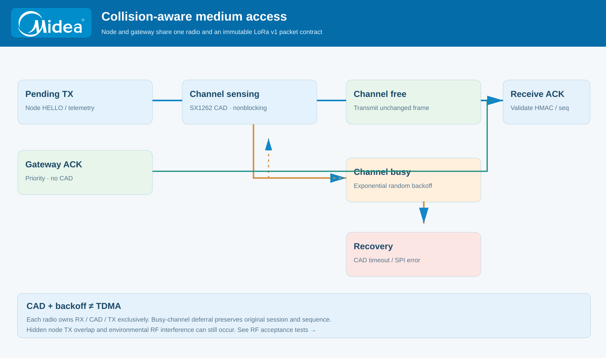
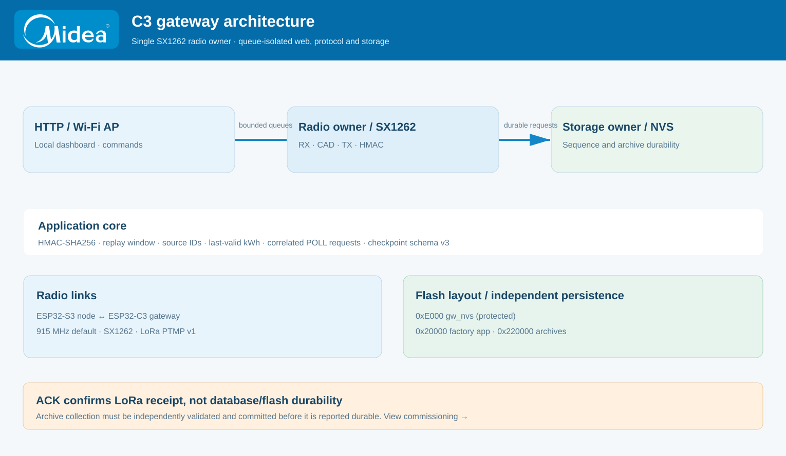

<p align="center"></p>

<h1 align="center">Energy Station · Gateway Monitoring Daya LoRa PTMP</h1>
<p align="center">ESP32-C3 + SX1262 · Modbus RTU via ESP32-S3 node · Dashboard web lokal</p>

<p align="center">


</p>
<p align="center">


</p>

<p align="center"><a href="README.md">English</a> · <a href="docs/PLATFORMIO_VSCODE.md">PlatformIO / VS Code</a> · <a href="docs/HARDWARE.md">Wiring</a> · <a href="docs/COLLISION_CONTROL.md">Collision control</a> · <a href="https://github.com/gedxxe/esp32-modbus-energy">Firmware node</a></p>

## Fungsi utama

Gateway ESP32-C3 menerima **paket LoRa Energy Station v1 yang terautentikasi** dari beberapa ESP32-S3 node. Pembacaan Modbus RS485, validasi dan perhitungan CT/PT terjadi di **node**. Gateway hanya melakukan verifikasi HMAC, pencegahan replay, korelasi transaksi, penyimpanan arsip terverifikasi dan penyajian nilai kWh yang sudah diskalakan melalui dashboard web lokal.

Semua node menggunakan satu kanal LoRa half-duplex. Gateway memberi prioritas ACK dan memeriksa kanal menggunakan **SX1262 Channel Activity Detection (CAD)** sebelum mengirim POLL. Firmware node pasangannya juga mendapat CAD non-blocking sebelum uplink, serta randomized backoff ketika kanal terdeteksi sibuk. Mekanisme ini mengurangi risiko tabrakan, tetapi **tidak menjamin bebas collision** jika ada hidden node atau interferensi.

## Jelajahi sistem melalui diagram

<table><tr><td width="50%" align="center"><a href="docs/assets/ptmp-topology.svg"></a><br/><b>01 · Topologi PTMP</b><br/><a href="docs/NODE_COMPATIBILITY.md">Identitas node &amp; protokol</a></td><td width="50%" align="center"><a href="docs/assets/wiring-c3.svg"></a><br/><b>02 · Wiring ESP32-C3</b><br/><a href="docs/HARDWARE.md">Detail GPIO dan pin modul</a></td></tr><tr><td align="center"><a href="docs/assets/poll-sequence.svg"></a><br/><b>03 · Alur komunikasi</b><br/><a href="docs/RADIO_DESIGN.md">POLL / TELEMETRY / ACK</a></td><td align="center"><a href="docs/assets/platformio-layout.svg"></a><br/><b>04 · Struktur PlatformIO</b><br/><a href="docs/PLATFORMIO_VSCODE.md">Setup VS Code</a></td></tr><tr><td align="center"><a href="docs/assets/channel-access.svg"></a><br/><b>05 · Pencegahan collision</b><br/><a href="docs/COLLISION_CONTROL.md">CAD + backoff</a></td><td align="center"><a href="docs/assets/gateway-architecture.svg"></a><br/><b>06 · Arsitektur firmware</b><br/><a href="docs/ARCHITECTURE.md">Radio, web dan storage</a></td></tr></table>

Klik diagram untuk membuka SVG ukuran penuh. Di GitHub, gambar yang di-embed tidak selalu mendukung klik hotspot internal SVG; tautan, daftar isi dan panel yang dapat dibuka-tutup di Markdown adalah navigasi utamanya.

## Struktur project sesuai PlatformIO VS Code

**Buka folder `esp32-modbus-energy-gateway/firmware/` di VS Code**, bukan folder root repository. File `platformio.ini` berada **di dalam `firmware/`**, dan PlatformIO otomatis mengenali folder `src/` serta `include/`.

```text
esp32-modbus-energy-gateway/
├── firmware/                 ← OPEN FOLDER DI VS CODE
│   ├── platformio.ini         ← [env:esp32c3]
│   ├── partitions.csv         ← partisi flash ESP32-C3
│   ├── src/                   ← file C++ yang dikompilasi
│   │   ├── main.cpp
│   │   ├── app/  core/  radio/  storage/  web/
│   ├── include/               ← header dan aset dashboard
│   │   ├── app/  board/  core/  storage/  web/
│   └── .vscode/               ← rekomendasi extension
├── dashboard/                 ← React + JavaScript
├── docs/                      ← dokumentasi dan SVG
├── tests/                     ← pengujian C++ native
└── tools/                     ← script QA dan packaging
```

<details open>
<summary><b>Build di VS Code / PlatformIO</b></summary>

Instal extension **PlatformIO IDE**, pilih **File → Open Folder → firmware**, lalu **PROJECT TASKS → esp32c3 → Build**. Board gateway yang ditentukan adalah `esp32-c3-devkitm-1` (4 MB flash tanpa PSRAM), sedangkan node menggunakan `esp32-s3-devkitc-1`. Platform pioarduino `55.03.311`, RadioLib `7.8.1` dan ArduinoJson `7.3.1` sama pada kedua firmware.

```powershell
# Terminal dari dalam folder firmware/
python -m platformio run -e esp32c3
python -m platformio device list
python -m platformio device monitor --baud 115200

# Atau dari root repository gateway
python -m platformio run --project-dir firmware -e esp32c3
python tools/test_native.py
python tools/check_compatibility.py
python tools/check_wiring.py
```

Untuk dashboard, masuk `dashboard/`, jalankan `npm ci`, `npm run build`, dan `npm test` sebelum kompilasi firmware bila ada perubahan antarmuka.

</details>

<details>
<summary><b>Parameter radio dan daya default</b></summary>

| Parameter | Nilai referensi |
| --- | --- |
| Perangkat gateway | ESP32-C3-DevKitM-1 |
| Transceiver | SX1262 Ra-01SH V1.1 |
| Frekuensi default | **915 MHz** |
| Bandwidth / spreading factor | 125 kHz / SF7 |
| Coding rate / preamble | 4/5 / 8 |
| Sync word | 0x12 |
| TX power default | **14 dBm** |
| Rentang power perangkat lunak | 0–22 dBm |
| Network / Gateway ID | 1 / 1 |
| Jumlah entri inventory | Maksimum 16 |

Nilai 14 dBm di pengaturan adalah daya keluaran radio, **bukan EIRP sistem**. Gain antena Moxon dan rugi kabel RF memengaruhi EIRP. Parameter bisa dikonfigurasi secara lokal pada kedua perangkat. [Referensi teknis dan aturan RF](docs/RF_COMPLIANCE_ID.md) tetap dipisah dari default source.

</details>

<details>
<summary><b>Bagaimana collision ditangani?</b></summary>

Paket dari setiap node memakai Network ID, Node ID dan kunci HMAC sendiri. Node melakukan contention awal, CAD sebelum uplink, retry/backoff jika kanal sibuk, dan tetap membatasi airtime. Gateway memprioritaskan ACK, mencadangkan antrean ACK, menggunakan satu radio owner, dan melakukan CAD sebelum POLL. Paket yang tertunda mempertahankan `session` dan `sequence` semula agar tidak menimbulkan pengulangan transaksi yang tidak terdeteksi.

**Bukan TDMA**: dua node tersembunyi tetap dapat memulai transmisi secara bersamaan. Pengujian fisik antena, lokasi panel, jarak dan interferensi diperlukan. [Desain collision control](docs/COLLISION_CONTROL.md) menjelaskan batas serta skenario pengujiannya.

</details>

<details>
<summary><b>Data kWh, keamanan dan flash</b></summary>

Angka **Request live** adalah hasil pengukuran terakhir yang disimpan node; belum berarti node menjalankan Modbus FC03 baru. Nilai valid terakhir tidak ditimpa nol jika kiriman baru invalid. Radio ACK berbeda dengan bukti arsip sudah tersimpan. Gateway menyimpan sequence ledger di partisi `gw_nvs` (0xE000), aplikasi di 0x20000 dan arsip di 0x220000. **Jangan jalankan `uploadfs` sebagai update rutin** karena dapat menimpa data arsip.

</details>

## Dokumentasi lanjutan

[Panduan instalasi](docs/COMMISSIONING.md) · [Wiring hardware](docs/HARDWARE.md) · [Arsitektur](docs/ARCHITECTURE.md) · [Desain radio](docs/RADIO_DESIGN.md) · [Kompabilitas node](docs/NODE_COMPATIBILITY.md) · [Validasi](docs/VERIFICATION.md) · [Lisensi](LICENSE)

Firmware node companion: [PR #5 (CAD PTMP)](https://github.com/gedxxe/esp32-modbus-energy/pull/5). Firmware gateway dan node harus sama-sama melalui uji RF fisik sebelum digunakan untuk monitoring operasional.

---
<sub>Midea Engineering · Diagram bersifat referensi teknis. Performa RF dan keamanan pemasangan perlu diverifikasi menggunakan perangkat fisik.</sub>
