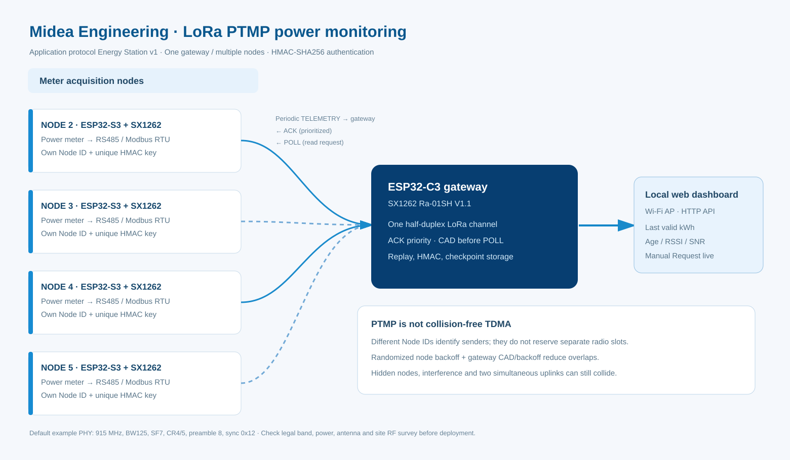
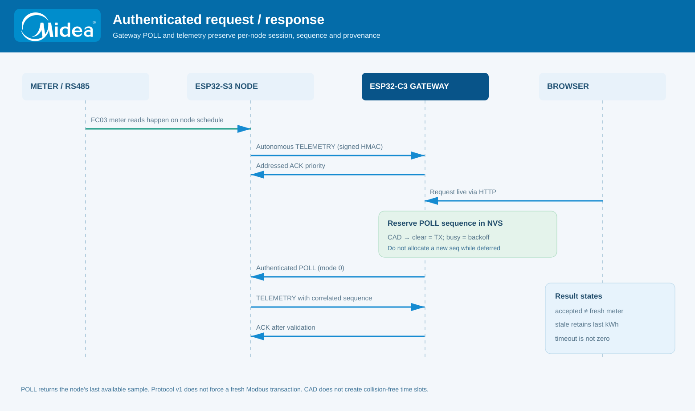
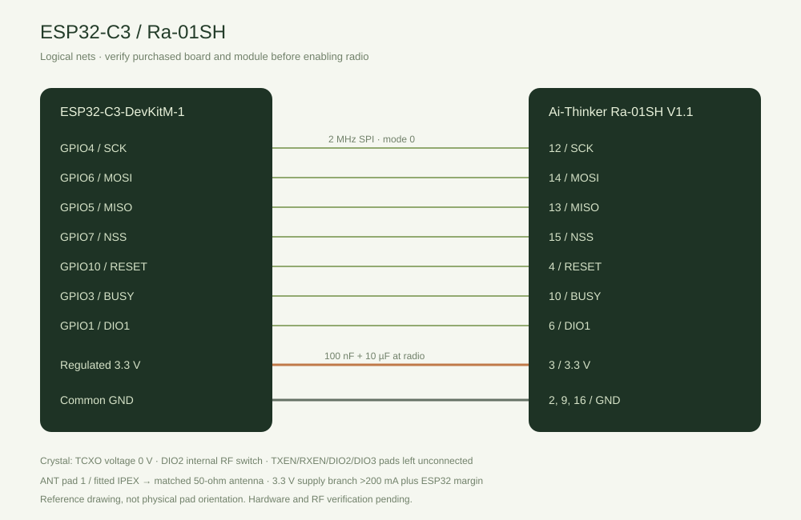
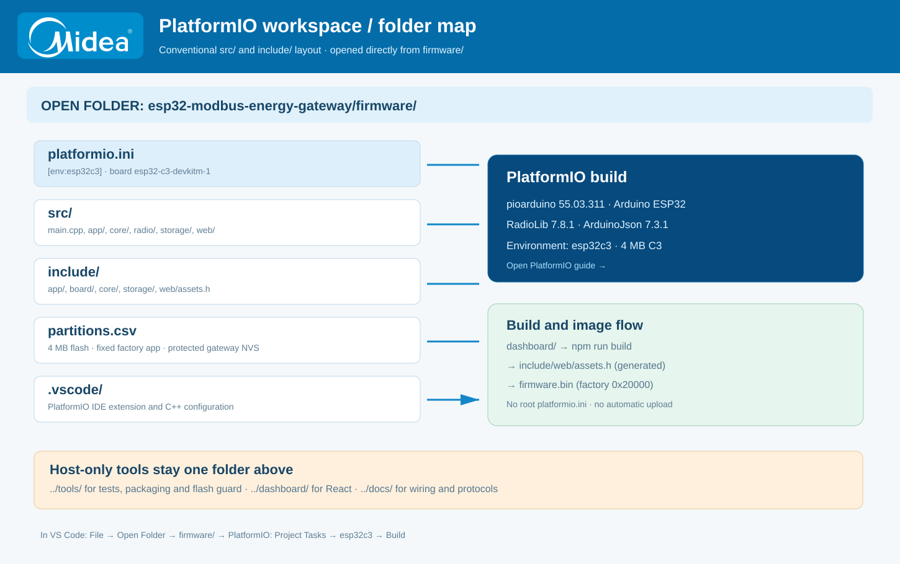

# Midea Engineering — LoRa Power Monitoring Gateway

[Bahasa Indonesia](README.id.md) · [PlatformIO / VS Code](docs/PLATFORMIO_VSCODE.md) · [C3 wiring](docs/HARDWARE.md) · [Medium access / collisions](docs/COLLISION_CONTROL.md) · [Node protocol](docs/NODE_COMPATIBILITY.md)

This project is the receiver for the [ESP32 power-meter node](https://github.com/gedxxe/esp32-modbus-energy). The node reads a meter over Modbus RTU, validates the reading and applies the meter's PT/CT ratios. This ESP32-C3 gateway listens for authenticated LoRa frames and exposes the received values on a local dashboard. The two repositories share the **Energy Station protocol v1**, not a shared firmware image. The node repository is the authoritative source for the radio packet format. Changes in this repository do not remotely update any node.



The receiver is currently built for **ESP32-C3-DevKitM-1**, not the ESP32-C6 gateway mentioned in older node documentation. The node firmware remains unchanged.

## Reading power-meter data

The dashboard keeps the last valid kWh reading visible with its source timestamp, receive age, meter profile, inventory ID and radio link status. A reading becomes **stale** as time passes, but the value is not erased or replaced by zero. A valid LoRa payload already contains scaled engineering kWh; the gateway **must never multiply by PT/CT again**. The current protocol does not transmit a full register map or every electrical measurement. Other parameters should be added only through a versioned change agreed by both node and gateway; inventing fields in the gateway would produce misleading data.

The operator can click **Request live** for a particular node. This asks the node to send the most recent Modbus-derived sample it currently holds; it does not command a new RS485 register transaction. The gateway sends an authenticated LoRa `POLL` with mode 0, and the node responds with a `TELEMETRY` frame containing the matching request sequence. This is an application-level request/response exchange, similar in intent to a read-only HTTP GET, but it is not HTTP transported over LoRa. The request is queued, then transmitted subject to the radio duty cycle and other pending packets. The dashboard distinguishes a queued request, an outstanding response, a received measurement and a timeout; merely accepting the HTTP command is not proof that the meter was read.



## One gateway, several nodes

A node can be configured locally to transmit once every hour. Because LoRa is half-duplex, simultaneous uplinks can interfere; assigning a one-hour interval to all nodes does **not** give each of them a guaranteed time slot. The gateway gives ACK frames priority, limits its own airtime, uses round-robin ordering for queued transmissions, checks channel activity with nonblocking SX1262 CAD before POLLs, applies bounded randomized backoff when the channel is busy, and does not start several stale-data POLLs together. If no valid update arrives for an hour plus a grace period, it can issue a low-priority refresh request. Unsuccessful automatic requests are rate-limited. These controls reduce congestion but are not TDMA and cannot eliminate collisions caused by independent transmitters. Full airtime and recovery assumptions are recorded in [radio design](docs/RADIO_DESIGN.md).

Each node must have a distinct radio ID and its own 32-byte HMAC key. The gateway supports up to 16 inventory entries, which is a storage limit rather than a radio capacity guarantee. Keys are configured locally, never sent in LoRa packets and are not returned through the dashboard API. LoRa payloads are authenticated but **not encrypted**; they should not contain personal data. Local checkpoint archives remain separate from the latest telemetry and are verified before being stored.

For the actual contention assumptions, hidden-terminal limitations, and fault counters, see [the medium-access design](docs/COLLISION_CONTROL.md). No gateway-only change can synchronize autonomous S3 transmitters into TDMA slots.

## Hardware and setup





The root `platformio.ini` configures `[env:esp32c3]`, with `board = esp32-c3-devkitm-1`. It uses the same pinned **pioarduino 55.03.311, RadioLib 7.8.1 and ArduinoJson 7.3.1** as the read-only ESP32-S3 node reference. See [PlatformIO instructions for VS Code](docs/PLATFORMIO_VSCODE.md) and run `python tools/check_compatibility.py` before building. The two MCUs are different by design; do not flash the node binary to the gateway.

The reference hardware is an **ESP32-C3-DevKitM-1 with an SX1262 Ra-01SH V1.1**. This is a board-specific reference, not a claim that an unknown module will work without checking wiring, RF-switch configuration and oscillator supply. The gateway starts with radio disabled and no enrolled nodes. The local commissioning AP and access code are announced on the Serial Monitor at 115200 baud, while the dashboard is served at `http://192.168.4.1`. The node's published recovery AP password remains a separate node-firmware setting; the gateway's commissioning credentials are not interchangeable with that password.

From the repository root, with Python 3, PlatformIO Core and a C++ compiler available:

```sh
python tools/check_compatibility.py
python tools/check_wiring.py
python tools/test_native.py
python -m platformio run -e esp32c3
```

To build the locally bundled dashboard, use Node.js 22 and run `npm ci`, `npm run build` and `npm test` inside `dashboard/`. The build regenerates `firmware/web/assets.h`; build the firmware **after** generating the dashboard. Normal firmware updates should not overwrite a device's archive partition. See [commissioning](docs/COMMISSIONING.md) before flashing or clearing flash.

## Security and acceptance

This is a local engineering installation, not an Internet-exposed service. The dashboard uses HTTP on a controlled AP and a temporary commissioning access code. At-rest flash encryption, a trusted gateway RTC, cloud synchronization and a managed multi-user login system are not provided. Host software tests and ESP32 compilation do not prove radio range, collision-free operation or accurate readings on a particular meter. The final acceptance procedure must include a real node, gateway and antenna installed at the intended locations. Repository hygiene checks are in `tools/security_audit.py`; local workstation paths, provisioning keys, compiled ELF files and temporary build output do not belong in Git.

[Source layout](docs/ARCHITECTURE.md) · [Validation](docs/VERIFICATION.md) · [Hardware](docs/HARDWARE.md) · [Licenses](NOTICE)

### Build artifacts and safe release

To produce a checked source-and-flash-image package, build both firmware and the **first-provisioning-only** LittleFS image, then run `python tools/package.py` and `python tools/package.py --verify`. The ZIP intentionally **excludes the ELF debugger file** because it can contain absolute workstation paths. A release manifest is generated from the exact Git revision and actual image bytes, not old test statistics. Normal firmware updates must preserve the `gw_nvs` sequence ledger and the `archives` LittleFS partition; never upload the blank LittleFS image to an operational gateway. CI publishes the packaged ZIP as a downloadable workflow artifact, not as a committed binary. See [PlatformIO/VS Code workflow](docs/PLATFORMIO_VSCODE.md).
