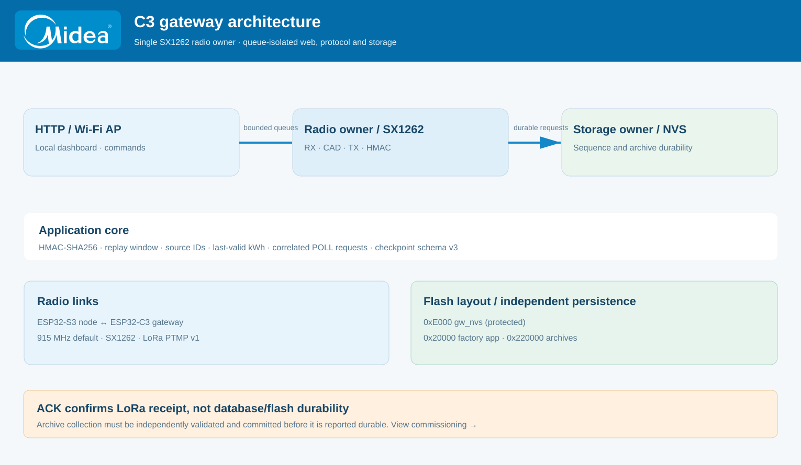
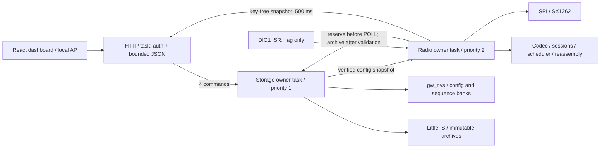

  

# Gateway firmware ownership and data flow

[README](../README.md) · [PTMP](COLLISION_CONTROL.md) · [PlatformIO](PLATFORMIO_VSCODE.md)

<b>Logical task / queue flow</b>

All application tasks are unpinned on the C3's single application core. The ISR only sets a flag. No HTTP/storage task calls SPI. No radio task writes flash. The HTTP task only reads snapshots and enqueues commands/exports. It may wait up to 500 ms for a queued archive export; this never owns filesystem access.

## Modules

`firmware/include/board` contains the board pin/module reference; the application is compiled from `firmware/src/` and headers are in `firmware/include/`. `core` is portable production C++ used unchanged by native tests. `storage` contains versioned bank, sequence reservation and archive logic. `app` connects these through FreeRTOS queues. `radio` is the sole SPI/RadioLib owner. `web` contains bounded local HTTP routes and generated React assets. `main.cpp` only starts services.

The radio owner uses nonblocking reset/BUSY/startup, RX, TX and 30-second recovery phases. Individual RadioLib SPI BUSY waits are limited to 100 ms and reset probing is disabled. Library initialization is synchronous within the owner and consists of bounded driver transactions; no whole-application busy-wait/reboot recovery is used. TX has airtime + 2 seconds completion bound and returns to RX after TX_DONE. PHY CRC failures and protocol authentication failures are separate counters.

## Explicit bounds

| Resource | Bound |
|---|---|
| Inventory | 16 `(network,node)` entries |
| Current / candidate | 1 each per node, established live data preserved |
| Replay | 16 sequence/tag slots per current/candidate session; older packets are rejected as replay |
| Durable sequence history | 64 non-evicted identity/session entries; blocks of 64 |
| TX work | 32 jobs; ACK priority; duplicate queued ACK coalescing; node round robin |
| HTTP commands / radio commands / storage work | 4 each |
| Storage completions / visible command results | 8 each |
| Checkpoint transfer | 1 global; 446 bytes + 446 byte coverage bitmap |
| Archives | 64 immutable records, no silent eviction |
| Logs | 32 lines × 112 bytes; reset at boot, export available |
| Command HTTP body / JSON nesting | 1536 bytes / 4 levels |
| AP clients / HTTP sockets | 2 / 2 |

Queue rejection, expiry, timeout, authentication, replay, driver, CRC and storage failures are observable. ACK jobs expire at 60 seconds; POLL jobs at 120 seconds. Response deadlines start only after successful POLL TX and include maximum contention (30 seconds), four maximum-packet duty periods plus 60 seconds; archives add eight duty periods. Timeout is reported as `timeout_unavailable`, since v1 has no missing-day response. No POLL retry repeats the sequence: the operator may request again, reserving a fresh sequence.

## Session trust

HELLO must authenticate against an enabled inventory key. It creates only a candidate. A successful HELLO ACK schedules one live challenge with a durably reserved fresh sequence. Only telemetry with that session and correlation after actual POLL TX promotes it. A recorded HELLO cannot replace established live state. New candidates are limited to one per node with a 120-second throttle. Current and candidate replay windows are bounded; valid duplicates are re-ACKed without updating records. Old or unrelated ACKs cannot finish POLL: node v1 responds with telemetry/fragments rather than ACKing POLL.

Keys identify configured addresses; there is no auto-enrollment, over-air key exchange, ID write, reboot, RTC write or radio-reconfiguration command. A single radio can recognize authorized logical networks from inventory, but uses one shared PHY and destination gateway address; the dashboard Network ID is the default for new inventory entries.

## Durability and recovery

Config and ledger use `GWB1` envelopes (version/kind/length/generation/CRC32), alternate banks and readback verification. Config can fall back to a valid bank. Any malformed existing ledger bank fails closed: an older high-water mark must never be reused after damage. The next sequence block is persisted before a sequence is returned to radio; reboot skips the entire previously reserved remainder. Entries are never evicted silently. A full/lost ledger blocks POLL and requires local recovery and node session rotation (see commissioning guide).

Checkpoint archives retain the exact 446 schema-3 bytes with network/node, session, correlation, gateway boot and monotonic receive timestamp in a CRC envelope. Idempotence compares day, revision and **all record bytes**, preserving captured identities/ratios/profile IDs. Conflicting content for an existing identity/day/revision fails. Inventory edits never relabel records. No filesystem format occurs at boot. Interrupted archive writes are detectable, existing records stay readable and new writes stop until recovery.

Packet acceptance, validated schema and verified durable write are separate counters/states. ACK is packet acceptance only. A crash between ACK and durable commit requires requesting the day again. Latest telemetry is RAM-only and resets at gateway reboot; it is not silently promoted to a scheduled or durable checkpoint. Receive age is monotonic plus boot identity; gateway UTC stays null. Source UTC/RTC-valid flags are preserved independently. Invalid/stale/missing energy displays `—`, never measured zero.

## Security and capacity

Raw v1 frames are authenticated with truncated HMAC-SHA256, **not encrypted**. Stored keys are not returned by status/log/export and are not placed in browser storage. Config at rest is plain NVS; encryption has not been configured. The AP has a fresh WPA2 password and HTTP has a fresh 128-bit commissioning code printed only at boot on Serial. Both reset on reboot. All data/command routes require the code in a custom header. Static assets contain no deployment credentials. HTTP is local and intended for trusted commissioning clients.

One per-boot 1% gateway airtime gate includes every ACK and POLL. Its wait is preserved across configuration edits, not power cycles. Dashboard estimates periodic ACK load from enabled nodes and an explicitly assumed node interval; it excludes retries, HELLO and archive work and is not measured RF capacity. Sixteen inventory slots are not a sixteen-node RF guarantee. Autonomous node uplinks still collide; this is not TDMA.

## Low-priority periodic data recovery

The gateway retains the most recent valid kWh measurement separately from the newest telemetry packet. An invalid newer energy sample updates the link's latest receive state without erasing a previously valid reading. The UI shows the earlier kWh with its age rather than treating it as a current measurement. The refresh policy in `core/refresh_policy.h` sends an authenticated POLL mode 0 after an hour and a two-minute grace period without a new valid update. It uses per-node retry suppression and at least 45 seconds between automatic requests. No automatic POLL starts while another downlink POLL, candidate challenge, checkpoint transfer, queued transmission or duty wait is active. ACK priority and manual read controls are unchanged. This is deliberately not TDMA; the node's own periodic uplinks and random backoff continue independently. See `RADIO_DESIGN.md` for frame correlation and collision limits.

## SX1262 channel access

Low-priority downlinks use `core/channel_access.h` and the nonblocking `RadioPhase::Cad` path in `radio/service.cpp`. The driver transitions between RX, CAD and TX while retaining one SPI owner. When the channel is busy, `Gateway::deferChannelBusy` requeues the *same* durable POLL sequence with a bounded randomized delay. ACKs still bypass CAD to preserve node acknowledgement latency. The `Gateway::nextTx` guard rejects timed-out or canceled POLL state before transmission. A CAD timeout or driver failure enters the existing bounded recovery path. The system does not implement TDMA or coordinated node uplink scheduling. See [medium access and acceptance criteria](COLLISION_CONTROL.md).

<b>Project boundaries</b>

| Directory | Responsibility |
| --- | --- |
| `firmware/src/core/` + `firmware/include/core/` | Portable application codec, scheduler, replay and checkpoint model |
| `firmware/src/radio/` | Sole SX1262 SPI owner and CAD / RX / TX state machine |
| `firmware/src/app/` | FreeRTOS queues and scheduling |
| `firmware/src/storage/` | NVS sequence and durable LittleFS archive |
| `firmware/src/web/` | Local HTTP handling |
| `dashboard/` | React sources and generated `firmware/include/web/assets.h` |

