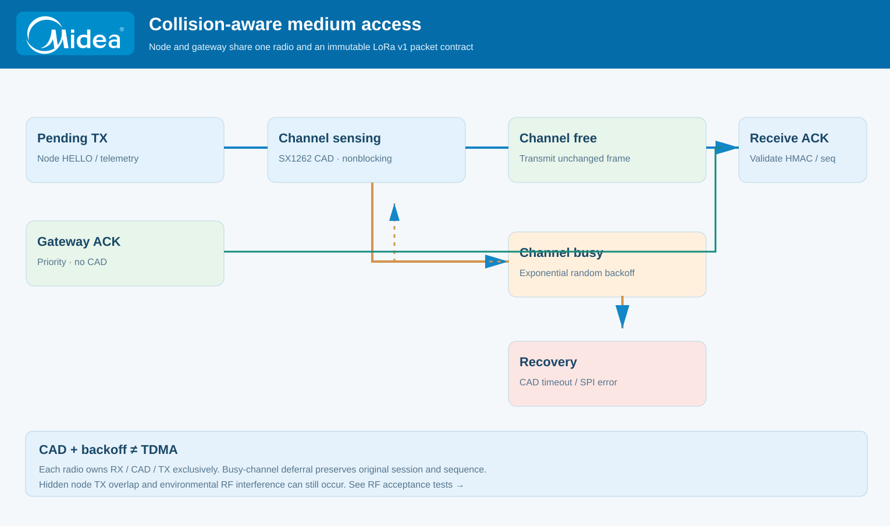
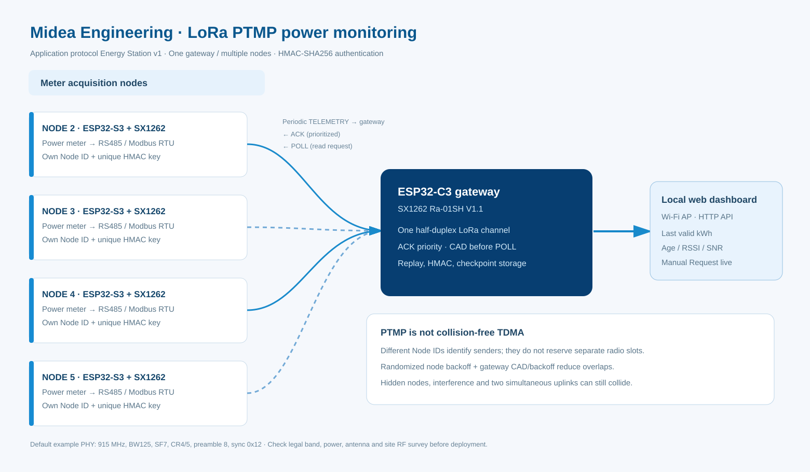

  

# LoRa PTMP · collision-aware medium access

[← README](../README.md) · [Topology](NODE_COMPATIBILITY.md) · [Request flow](RADIO_DESIGN.md) · [PlatformIO](PLATFORMIO_VSCODE.md)

**Compatibility contract:** the gateway and ESP32-S3 node use the unchanged **Energy Station protocol v1**. At the source defaults, both use **915 MHz, BW 125 kHz, SF7, CR4/5, preamble 8, sync 0x12, CRC enabled and 14 dBm configured TX power**. Node application packet fields and HMAC tags do not change when the channel access method changes.

## Architecture

| Layer | Gateway ESP32-C3 | Node ESP32-S3 |
| --- | --- | --- |
| Radio owner | One FreeRTOS task owns SX1262 SPI / RX / CAD / TX | One FreeRTOS radio task on its supported application core |
| Uplink scheduling | Listens to independent node uplinks | Autonomous HELLO, TELEMETRY, CHECKPOINT |
| Channel sensing | CAD before **POLL**; priority ACK bypasses CAD | CAD before **every uplink** in audited node main |
| Congestion handling | Shared TX airtime gate, ACK queue reserve, fair scheduling | Hardware-random bounded exponential backoff; original frame retained |
| Retransmission | POLL sequence is reserved durably, not changed while CAD defers | Retries preserve immutable bytes, session and sequence |
| Packet integrity | Per-node HMAC key, address, session, replay window and correlation | Validate HMAC, destination, session and exact ACK / POLL sequence |
| Flash safety | Durable POLL counter before transmission | Existing local checkpoint journal independently preserved |

<b>How channel sensing works</b>

The SX1262 uses RadioLib `startChannelScan()` without blocking the radio task. An interrupt indicates that CAD has completed; `getChannelScanResult()` returns whether LoRa activity was detected. A clear result proceeds to the pending TX. A busy result returns to RX and defers transmission using a bounded random delay; the pending LoRa v1 frame **is not re-encoded with a different sequence**. A CAD error or timeout is counted separately and follows the recovery path. Both implementations can still receive a delayed matching ACK during a later retry-backoff interval.

Gateway ACKs are **not delayed by CAD** because the sender is already awaiting an acknowledgment. ACKs still obey the shared radio-owner and pacing budget. The gateway reserves **16 of its 32 TX queue entries** for ACK traffic, so optional manual or automatic requests cannot occupy every queue slot.

<b>Why this is not guaranteed zero-collision TDMA</b>

CAD detects LoRa activity visible to the particular radio and at the selected PHY. Hidden nodes behind different walls can both see a clear channel and transmit simultaneously. Interference from other radio technologies may not be identified by LoRa CAD. Likewise, a gateway POLL or ACK cannot be guaranteed to reach a radio that is transmitting at the same instant because SX1262 is half-duplex.

This design is **CSMA/CA-like with bounded randomized contention**, not negotiated TDMA. True scheduled collision avoidance requires a new jointly implemented and tested protocol version with a trustworthy common timebase, slot grants, guard bands for clock drift, failure/rejoin behavior and a fallback contention window. Retaining protocol v1 avoids deploying an incompatible node while such features are still unverified.

<b>Airtime and capacity calculation</b>

At the default SX1262 settings, the current gateway's RadioLib-compatible airtime equation calculates a **41-byte ACK ≈ 87.296 ms** and a **72-byte TELEMETRY ≈ 133.376 ms**. The one-percent pacing gate delays the next gateway downlink by roughly 100× the previous TX airtime. This is a device-local budget and cannot replace checking aggregate traffic or radio rules.

For example, four nodes each producing one acknowledged telemetry uplink per minute require about **4 × 87.296 ms × 60 = 20.95 seconds of ACK TX per hour**, approximately **0.58% gateway duty**, before HELLOs, archive fragments, POLLs, retries and RF losses. An automatic POLL has a separate packet length and must also enter the duty budget. Increasing SF or channel loading can rapidly change this balance. Inventory capacity of 16 nodes is **not** a measured network capacity.

<b>Recommended hardware acceptance</b>

1. Flash the matching node and gateway firmware, verify correct board ID and SPI pins, then connect matched antennas before enabling TX.
2. Pair one node: verify signed HELLO → gateway ACK → fresh correlated POLL/TELEMETRY, HMAC and address isolation.
3. Add nodes 3, 4 and 5 with separate keys and RS485 buses; observe received samples, successful ACKs, duplicate counters, RSSI/SNR, CAD-busy/clear/errors and queue drops.
4. Compare live and checkpoint kWh against the originating node's validated capture; no double CT/PT scaling and no invented zero on invalid readings.
5. Inject simultaneous transmissions, RF attenuation, node resets and gateway power interruption. Confirm bounded requests, missing-day semantics, replay rejection, recovery and archive durability.
6. Document actual antenna gain, feeder loss, output power, airtime, signal quality, report success ratio and worst-case latency. A software build does not establish factory-wall range or zero collisions.

## Source references and counters

Gateway sources: `firmware/src/radio/service.cpp`, `firmware/include/core/channel_access.h`, `firmware/src/core/gateway.cpp`, `firmware/src/core/scheduler.cpp`. Node counterpart (read-only): [LoRa worker and protocol on audited main](https://github.com/gedxxe/esp32-modbus-energy/tree/3896a8b46bd2cd63f9756a46f0b4198a20aac6c2/firmware). The gateway status API exposes `cadBusy`, `cadClear`, `cadErrors`, `cadDeferred`, ACKs, HMAC failures, timeouts and queue drops. The node companion exposes the same four CAD counters.

See [radio engineering and legal RF reference](RF_COMPLIANCE_ID.md). **The 915 MHz source default is retained**, while permitted on-air operation, EIRP and equipment certification remain site-specific checks.
