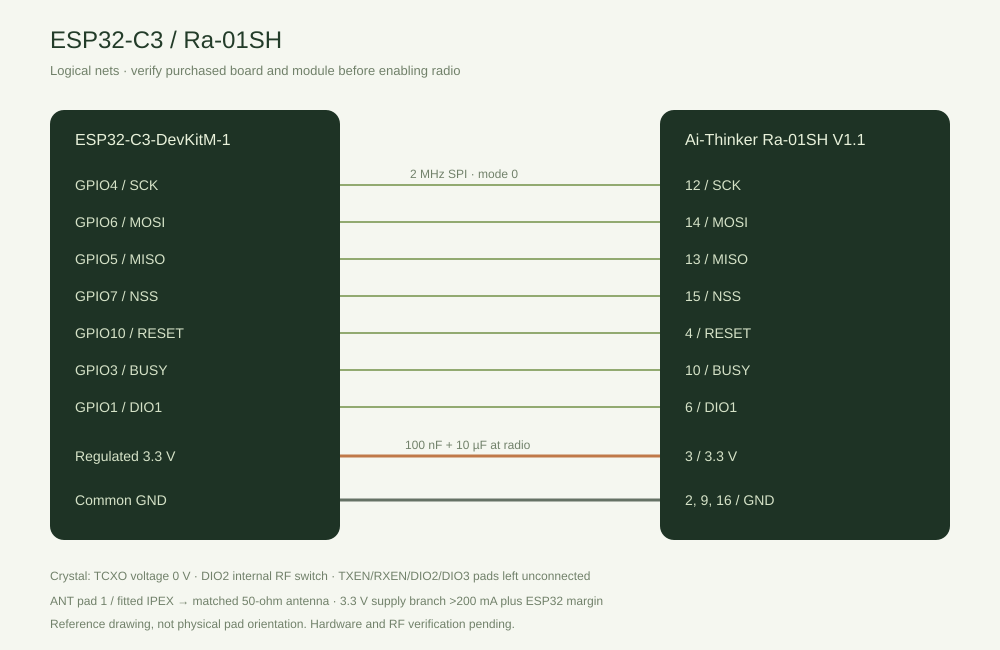

# Commissioning and recovery

This guide is an acceptance procedure, **not evidence that hardware testing has happened**. Current RF status is in WORK_STATUS.md. Start with one node, then three. Keep a copy of node/gateway configurations outside the device in the installation credential record; do not paste pairing keys into support logs.

## Build and first provisioning

Use Python 3, PlatformIO Core 6.1.19, Node.js 22 and npm. See pinned versions in platformio.ini/package-lock.json. The reference uses a 4 MB ESP32-C3-DevKitM-1. Commands below are **host terminal INPUT**, from the gateway root unless stated otherwise:

```powershell
python -m platformio run -e esp32c3
python -m platformio run -e esp32c3 -t buildfs
python tools/test_native.py
```

Dashboard **host terminal INPUT**, from `dashboard/`:

```powershell
npm ci
npm run build
npm test
```

The generated `firmware/web/assets.h` is included so a firmware build does not need npm. After editing UI source, rebuild it **before** compiling firmware. For a first empty device only, upload the filesystem image with `python -m platformio run -e esp32c3 -t uploadfs --upload-port COMx`. **This replaces all archive files. Never use uploadfs as a routine firmware update.** Upload application with `python -m platformio run -e esp32c3 -t upload --upload-port COMx` and inspect the current partition layout first. Any newly generated release manifest must reflect the exact current build; verify with `python tools/package.py --verify` after packaging. Do not rely on deleted legacy release artifacts.

Do not flash automatically to an unidentified COM device. Firmware/source packages contain no installation keys or credentials. Reusing an installation's still-running node sessions requires preserving `gw_nvs` sequence history. An all-flash erase is a recovery event, not a routine update.

Read the [PlatformIO / VS Code build guide](PLATFORMIO_VSCODE.md), [wiring reference](HARDWARE.md), and [medium-access design](COLLISION_CONTROL.md) before connecting the module.



## One node

1. With power removed, check actual board markings, all reference nets, supply, ground, antenna and module circuit against HARDWARE.md. Record the board/module revision and wiring differences. Do not enable TX until verified.
2. Open Serial Monitor at 115200. On boot, **OUTPUT** prints the AP SSID, boot-only AP password, URL and commissioning access code. Connect to that AP and enter the code in the login page. This is local HTTP on a trusted WPA2 AP. Neither code nor pairing key belongs in browser storage.
3. In **Node inventory → Add node**, set network 1, node 2, a name/location and a unique nonzero 32-byte hexadecimal key matching that node's local settings. The node generates/holds its key; gateway has no unauthenticated over-air enrollment. Stored keys cannot be read back. Enable the inventory entry and save. Wait for the visible save result and later applied revision.
4. In **Gateway & radio**, match the node PHY: 915 MHz, BW125, SF7, CR4/5, preamble8, logical sync18 by default. Verify deployment-appropriate settings on both ends. Set gateway1 and network1, enable radio, and save. These settings change the gateway only.
5. Distinguish `configured`, `initialized`, HELLO ACK sent, session confirmed, and fresh data. `initialized=true` only establishes driver/SPI initialization. Verify HELLO ACK, gateway live POLL with correlated telemetry, then current session and source/sample/receive ages. A candidate alone is not reachability proof.
6. Compare kWh with node display/export. The node has already applied engineering scaling. Keep Modbus slave ID, saved meter ID and immutable profile ID distinct from radio Node ID. Verify that an invalid update never becomes a numeric zero; an earlier valid kWh remains visible but is labelled stale with its age, while a node without any valid reading displays `—`.
7. Use **Request live** once, observe its new correlation and result; prefer normal periodic telemetry thereafter. Use **Request checkpoint** with a known WIB day, or 0 for node's active capture day. Confirm five normal fragments, interleaved telemetry handling, validated and then durable states. Export JSON in **Checkpoints** and compare all ten captures, immutable source profile/meter/ratios, times and kWh against node export.
8. Request a known missing day: v1 sends no fragments. Expected result is timeout/unavailable. Do not accept an empty successful archive. At slow PHYs, response deadlines can be several minutes.
9. Restart gateway while node remains on. Verify the same-session POLL sequence skips beyond its reserved block, no recorded HELLO promotes online state, and established data is replaced only after a fresh correlated response. Separately power-cycle/re-pair the node to verify a genuinely new node session.
10. Remove radio power only with safe bench handling; gateway must report driver error/recovery without reboot loops and keep AP/dashboard responsive. Reconnect, allow 30-second recovery, and recheck SPI, HELLO and session confirmation. Record supply measurements and driver codes rather than inferring damage from empty RX.

## Three nodes and capacity

Add node3 and node4 one at a time, each with its own key and commissioning notes. All can have Modbus slave1 on their separate local cables. Confirm source rows never mix, live POLL correlation cannot complete another node's transaction, and checkpoint retrieval from one node coexists with periodic telemetry from the others. Only one checkpoint transfer is allowed globally.

Record PHY, actual node intervals, gateway ACK/POLL airtime, retries/drops/timeouts, RSSI/SNR and the test duration. The dashboard's capacity interval is a calculation assumption; changing it does not change node firmware settings. Default calculated 41-byte ACK airtime is 87.296 ms, so three ACKs/minute consume about 0.43648% gateway TX before retry/HELLO/archive work. Increasing node count or SF requires a new calculation and measurement. Observe collisions and ACK gate backlog; extend intervals on nodes before increasing load further. There is no TDMA, mesh or multichannel reception.

Bench power interruptions must test config save, sequence reservation and archive commit separately. After each restart, check bank health and compare exported durable records. Native interrupted-write tests do not establish actual brownout behavior or zero data loss.

## Diagnostics inputs and support output

**Serial Monitor INPUT + Enter**:

```text
help
status
```

**OUTPUT** example, illustrative only:

```text
OUTPUT: phase=receiving initialized=1 driver=0 accepted=12 auth=0 replay=0 archive=1 UTC=unavailable
```

Copy the `status` OUTPUT and dashboard **Diagnostics → Export bounded log** for support. Remove boot access/AP codes if sharing the serial startup transcript. The web interface uses labelled buttons, not a free-form command interpreter.

Read diagnostics in order: initialization/SPI → RF observations → authenticated protocol counters → per-node correlation/session/record durability. RX empty is an observation; wiring, PHY mismatch, interference and module faults are hypotheses requiring further measurements. Firmware does not report node retry counters that v1 never transmits; duplicate arrivals are reported separately. A POLL postponed because CAD detects a busy channel is requeued **before transmission** with its original reserved sequence. An already transmitted POLL that times out is not resent automatically; a new operator request uses a new sequence.

## Recovery, identity changes, capacity limits

- **Inventory edit/disable/delete:** save/apply clears sessions and queued work for reconfirmation. Disabled/unknown nodes are rejected. Historical archive source identities remain unchanged. Changing a node address requires physically/local-configuring the node, then updating inventory with the intended key. No v1 remote ID setter exists.
- **Config bank damage:** a valid alternate bank can recover old settings. Review the applied revision and node keys locally. If both banks fail validation, edits are blocked. Export recoverable records and preserve a raw flash backup before maintenance.
- **Sequence bank missing/corrupt or 64-session ledger full:** POLL fails closed. Never erase only the ledger and resume the same node session. Preserve a flash backup and rotate the affected nodes' sessions using their local Pair again/reboot (or reconfigure keys/address locally) **while gateway radio is disabled**. Only after confirming all retained same-session state is retired may a technician deliberately reinitialize gateway config/ledger in a maintenance build/flash procedure. This MVP has no remote reset or automatic ledger-pruning button. A complete flash erase also requires new node sessions, because absence of both installation/config banks cannot distinguish a virgin device from erased state.
- **Archive mount/CRC failure:** no autoformat, no silent repair, no eviction. Preserve a raw partition backup. Already readable records may be exported. Request affected days from node again after deliberate offline repair/provisioning. A full 64-record store rejects new durable writes; ACK still means packet acceptance only. Export/backup and provision a maintained store deliberately; retention cleanup is outside this MVP.
- **Power loss after ACK before durable write:** request the day again. The node does not delete checkpoints on ACK. Equal existing day/revision content is idempotent; conflicting immutable content is an error, never automatic merge.

## Hardware evidence sheet (all pending)

| Test | Required evidence | Status |
|---|---|---|
| Board/module/wiring/supply | Photos, markings, voltages, circuit population | AWAITING_HARDWARE |
| One node HELLO/challenge/telemetry | Both serial logs, sessions/sequences/correlation | AWAITING_HARDWARE |
| Checkpoint and missing day | Node export vs gateway JSON, CRC/durable state | AWAITING_HARDWARE |
| Three node coexistence | Addresses/keys separately verified, counter timeline | AWAITING_HARDWARE |
| Gateway reboot / node reboot | Sequence reserve continuity, new-session proof | AWAITING_HARDWARE |
| Absent module / BUSY / brownout | Driver recovery + AP responsiveness, flash recovery | AWAITING_HARDWARE |
| Capacity and range | Actual intervals/PHY/load, location/antenna, loss statistics | AWAITING_HARDWARE |

## PlatformIO validation / safe release package

Open the repository **root** in VS Code with PlatformIO IDE and select the environment `esp32c3` (board ID `esp32-c3-devkitm-1`). The node project uses `esp32-s3-devkitc-1`; they share the same pinned platform URL, RadioLib and ArduinoJson, not a binary image. Check `docs/PLATFORMIO_VSCODE.md` for VS Code setup and `docs/COLLISION_CONTROL.md` for gateway CAD and half-duplex limitations. `python tools/check_compatibility.py` and `python tools/check_wiring.py` are preflight checks. Once firmware is built, `python -m platformio run -e esp32c3 -t buildfs` makes a *local* blank filesystem image, and `python tools/check_flash_layout.py` checks partition offsets; neither action uploads data to a connected device. `python tools/package.py` creates a source + image ZIP **without ELF**, and `--verify` checks its hashes. Do not use the included `littlefs.bin` during a routine update because it overwrites checkpoint archives.

## Regional RF compliance gate (Indonesia)

Both source repositories contain a legacy default carrier of 915 MHz; this is not the recommended authorized LPWAN carrier at an Indonesian factory. **Leave RF disabled** until both devices have been set to a common 920–923 MHz frequency (for example 921 MHz) and checked against the current local class-license rules. The 2025 Komdigi LPWAN table also specifies a maximum 250 kHz bandwidth and a 1% maximum uplink/downlink duty cycle. See [RF compliance checklist](RF_COMPLIANCE_ID.md). Do not use a successful LoRa SPI initialization as evidence that legal transmission is permitted.
