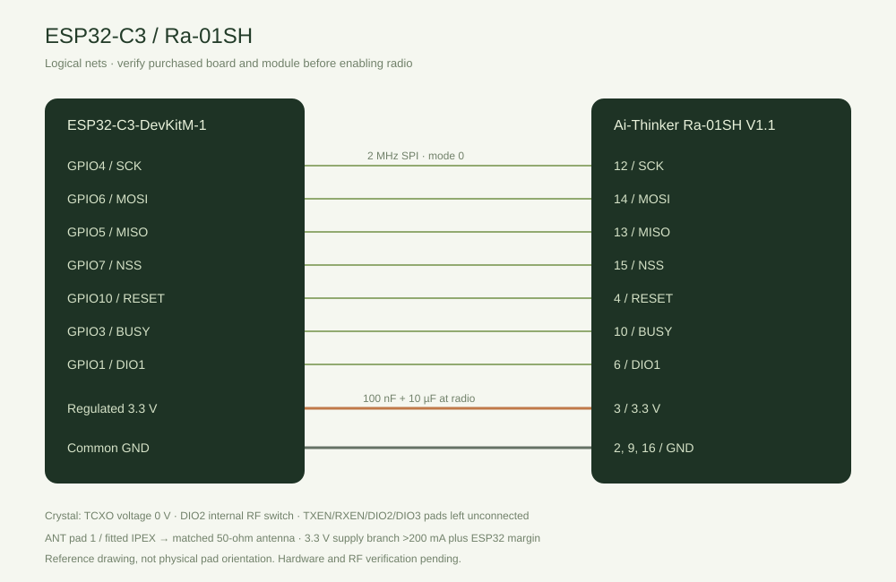

# ESP32-C3 reference hardware

The owner corrected the first target to **ESP32-C3**. The actual development-board model has not been supplied. This implementation selects **Espressif ESP32-C3-DevKitM-1**, 160 MHz single application core, 4 MB flash, no PSRAM. It uses the onboard USB-to-UART bridge for upload/115200-baud diagnostics. Native USB pins GPIO18/19 are preserved. GPIO20/21 UART, GPIO8 LED, strapping GPIO2/8/9 and flash GPIO12–17 are not used by the radio adapter. GPIO4–7 can no longer be used for external pad JTAG when wired to the radio.

Board basis: [Espressif user guide](https://docs.espressif.com/projects/esp-dev-kits/en/latest/esp32c3/esp32-c3-devkitm-1/user_guide.html). The installed pinned PlatformIO board definition was inspected; it agrees on MCU, 4 MB flash and 160 MHz. Arduino-ESP32 3.3.11 and RadioLib 7.8.1 are compiled for C3; runtime electrical/RF support still requires commissioning.

## Wiring

GPIO labels below are **not header pin ordinals**. This reference must be checked against the purchased board before enabling radio. Edit only `firmware/board/reference.h` for a different board and add/verify its build environment. Protocol/inventory/application code has no pin constants.

| DevKitM-1 signal | Ra-01SH pad | Net | Direction from C3 |
|---|---|---|---|
| GPIO4 | 12 | SCK | Output |
| GPIO6 | 14 | MOSI | Output |
| GPIO5 | 13 | MISO | Input |
| GPIO7 | 15 | NSS/CS | Output |
| GPIO10 | 4 | RESET | Output |
| GPIO3 | 10 | BUSY | Input |
| GPIO1 | 6 | DIO1 | Input / interrupt |
| Regulated 3.3 V | 3 | 3V3 | Supply |
| Common GND | 2, 9, 16 | GND | Connect all ground pads |
| Matched antenna | 1 / fitted IPEX | ANT | 50-ohm RF connection |

Machine-readable companion: [wiring-c3.csv](wiring-c3.csv). Drawing is a logical net diagram, not the physical module orientation. Use the manual's pad diagram for assembly. Radio SPI is 2 MHz mode 0.

## Crystal and RF switch evidence

The **Ai-Thinker Ra-01SH Specification V1.1** was downloaded from its [distributor-hosted manufacturer PDF](https://mm.digikey.com/Volume0/opasdata/d220001/medias/docus/7169/RA-01SH.pdf). SHA256: `b45257e1df1f24644dbcb1e46ddef1747aba1fc16d7e65bed6a9b8959ef4ac86`, matching the node repository's recorded manual. Pages 11 and 12 were rendered and visually inspected on 2026-11-04.

Page 12 shows Y1 crystal between XTA/XTB, and DIO2 through R8 to the RF-switch control path. For that circuit the adapter sets `tcxoVoltage=0` and `setDio2AsRfSwitch(true)`. Leave exposed TXEN/RXEN/DIO2/DIO3 pads unconnected. Do not infer external pin drive from the inconsistent TXEN/RXEN labelling or the manual's unrelated register DIO mapping table. A different circuit population requires a new adapter review.

Use regulated 3.3 V, never 5 V or a GPIO supply. The manual asks for more than 200 mA capability on the module branch; allow additional ESP32 Wi-Fi current. Put 100 nF and 10 µF decoupling close to the module, use short SPI wiring, and connect a matched antenna before enabling TX. Supply/regulator capacity, real pad orientation, purchased switch population and RF performance are **AWAITING_HARDWARE**.

## Flash layout

| Partition | Offset | Bytes | Purpose |
|---|---|---|---|
| nvs | 0x9000 | 0x5000 | Framework/Wi-Fi NVS |
| gw_nvs | 0xE000 | 0xB000 | Dedicated config and sequence banks; never auto-erased |
| phy_init | 0x19000 | 0x1000 | PHY calibration |
| factory | 0x20000 | 0x200000 | Single application; no OTA |
| archives | 0x220000 | 0x1E0000 | LittleFS, 64 immutable record slots |

The filesystem image is for **initial provisioning only**. Reflashing it overwrites archives. Ordinary application updates must preserve `gw_nvs` and `archives`.
