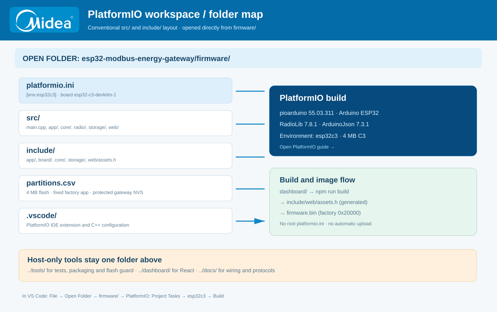

<p align="left"></p>

   

# Open this ESP32-C3 gateway in PlatformIO / VS Code

**Open `esp32-modbus-energy-gateway/firmware/` as the Visual Studio Code folder.** The `platformio.ini` is in that folder, the same project organization used by the ESP32-S3 meter-node repository. Do not use the repository root as the PlatformIO project. There is a real `src/` folder: PlatformIO automatically discovers C++ files under its nested folders.

[← README](../README.md) · [Bahasa Indonesia](../README.id.md) · [Wiring](HARDWARE.md) · [Radio protocol](NODE_COMPATIBILITY.md) · [CI](VERIFICATION.md)

<a href="assets/platformio-layout.svg"></a>

<details open>
<summary><b>Step 1 · Select the correct workspace</b></summary>

```text
esp32-modbus-energy-gateway/           Git repository root (tools/docs/dashboard)
└── firmware/                         OPEN THIS DIRECTORY IN VS CODE
    ├── platformio.ini                platformio environment: esp32c3
    ├── partitions.csv                C3 4 MB flash layout
    ├── .vscode/                     recommended extensions and IntelliSense
    ├── src/
    │   ├── main.cpp                 Arduino setup()/loop()
    │   ├── app/                     task/queue/storage ownership
    │   ├── core/                    portable protocol, HMAC, scheduler, records
    │   ├── radio/                   SX1262 SPI driver / CAD / RX / TX
    │   ├── storage/                 durable banks and archive encoding
    │   └── web/                     ESP-IDF HTTP server
    └── include/
        ├── app/  board/  core/  storage/  web/
        └── web/assets.h             generated offline dashboard
```

PlatformIO's default `src_dir = src` and `include_dir = include` are intentionally used, so no nonstandard `src_dir = firmware` setting is needed. The root contains only host tools and documentation; `platformio.ini` is **not** duplicated at root.

</details>

<details>
<summary><b>Step 2 · Install extensions and build</b></summary>

Install **PlatformIO IDE** in VS Code. The embedded `.vscode/extensions.json` recommends PlatformIO and Microsoft C/C++ tools. Select `esp32c3` under **PROJECT TASKS → esp32c3 → General → Build**.

| Build parameter | Pinned value |
| --- | --- |
| Platform | pioarduino `55.03.311` |
| Framework | Arduino ESP32 |
| Board ID | `esp32-c3-devkitm-1` |
| Toolchain language | C++17 |
| RadioLib | `7.8.1` |
| ArduinoJson | `7.3.1` |
| Serial Monitor | 115200 baud |
| GPIO | See [Ra-01SH wiring netlist](HARDWARE.md) |

```powershell
# Terminal inside firmware/:
python -m platformio run -e esp32c3
python -m platformio device list
python -m platformio device monitor --baud 115200

# From the Git repository root:
python -m platformio run --project-dir firmware -e esp32c3
python tools/check_compatibility.py
python tools/check_wiring.py
python tools/test_native.py
```

When uploading, identify the actual serial port and verify the correct physical board. Do not flash an ESP32-S3 firmware image onto an ESP32-C3.

</details>

<details>
<summary><b>Step 3 · Regenerate the offline React dashboard</b></summary>

UI sources are deliberately kept **outside firmware/** at `dashboard/`. The generated gzip bundle is embedded in `firmware/include/web/assets.h`, so a normal PlatformIO firmware build does not need Node.js after the asset has been generated.

```powershell
# Terminal from repository root:
cd dashboard
npm ci
npm run build
npm test
cd ..

python -m platformio run --project-dir firmware -e esp32c3
```

CI fails if regenerating the React bundle changes the committed `assets.h` unexpectedly. The generated JavaScript and CSS are served offline by the gateway and do not require a CDN.

</details>

<details>
<summary><b>Step 4 · Preserve flash and archive data during updates</b></summary>

The gateway uses a fixed **factory app** instead of OTA. The `tools/pio_flash_guard.py` post script belongs to the host repository and is referenced as `post:../tools/pio_flash_guard.py` from `firmware/platformio.ini`. It prevents pioarduino's default upload path from overwriting the gateway's persistent `gw_nvs` sequence ledger at 0xE000.

| Offset | Partition | Purpose |
| --- | --- | --- |
| 0x9000 | nvs | Framework/Wi-Fi |
| 0xE000 | gw_nvs | Persistent keys/config and POLL sequence reservations |
| 0x20000 | factory | 2 MiB application |
| 0x220000 | archives | LittleFS capture archives |

Do not run `uploadfs` as part of a routine firmware update; that erases the archive partition. The first-provisioning filesystem can be **built without uploading**:

```powershell
python -m platformio run --project-dir firmware -e esp32c3 -t buildfs
python tools/check_flash_layout.py
python tools/package.py
python tools/package.py --verify
```

A release ZIP is verified against source and image SHA256 and intentionally excludes ELF files containing potential workstation paths.

</details>

<details>
<summary><b>Cross-firmware PTMP alignment</b></summary>

The node is a different target: `esp32-s3-devkitc-1`, with its own `firmware/platformio.ini`. Both share **pioarduino 55.03.311**, **RadioLib 7.8.1**, **ArduinoJson 7.3.1** and **Energy Station protocol v1**. The ESP32-S3 node additionally requires OLED/RTC libraries, while the C3 gateway does not. **Radio settings are local to each device**; matching package versions do not automatically synchronize node IDs, PHY or pairing keys.

Default PHY on both sides remains **915 MHz / 125 kHz / SF7 / CR4/5 / 14 dBm**. Conducted TX power is not the same as EIRP after accounting for antenna gain and cable losses. See [RF reference](RF_COMPLIANCE_ID.md) and [collision-aware PTMP](COLLISION_CONTROL.md).

</details>

> GitHub SVG previews are clickable as full-image links. The diagrams also include embedded document links for SVG viewers that support them; expandable sections are the supported interactive reading experience inside GitHub Markdown.
